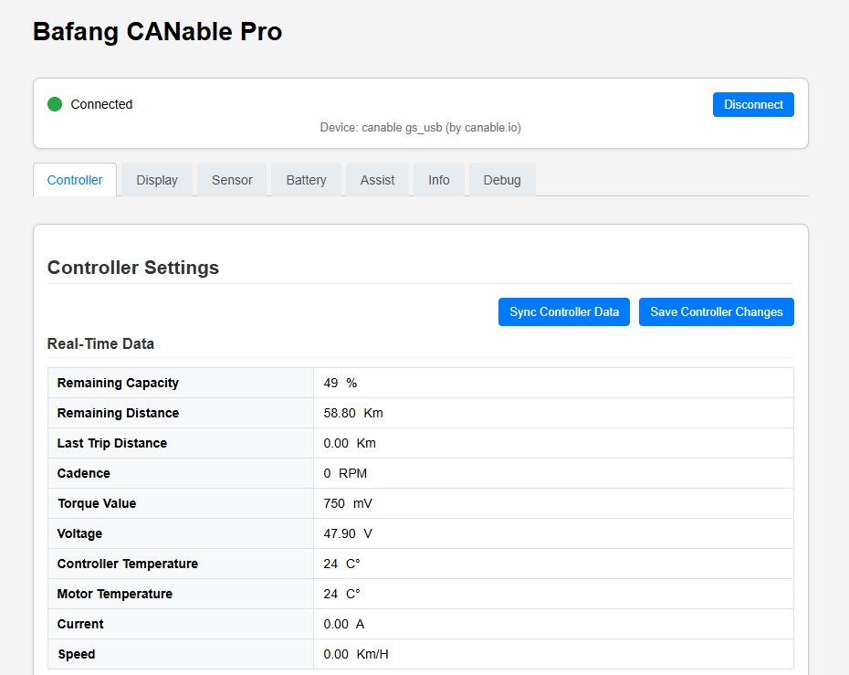
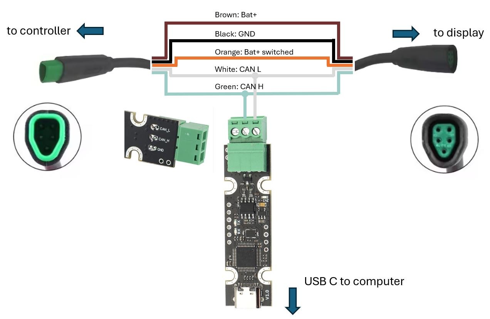

# Bafang Besst software replacement for M500, M510, M560, M820 etc  

# Steps to run the software

## Get hardware 
 - Canable with STM32F072 or STM32G431 processor and candlelight firmware ([Ebay](https://www.ebay.com/itm/156316405598),[Aliexpress](https://pl.aliexpress.com/item/1005006029234562.html))
 - 5 pin Cable with male and famale plugs ([Ebay](https://www.ebay.com/itm/197421023105),[Aliexpress](https://pl.aliexpress.com/item/1005005307670708.html))

## Wire the Canable (UCAN module example)

## Run the software from executable
- Download and run last [release](https://github.com/mdi-9/bafang_canable_pro/releases)
- Open [localhost:8080](http://localhost:8080)

## Or run the software from source code
- Install nodeJS and npm
- Download source code for last [release](https://github.com/mdi-9/bafang_canable_pro/releases)
- Unzip and open folder in terminal
- Run `npm install` in terminal to download all dependencies
- Run `node server.js` in terminal

## Or run it in the browser, no install (experimental)
The whole application also runs inside the browser and talks to the CANable directly over WebUSB. Nothing to install, and it works on Android phones too.

**Open it:** [mdi-9.github.io/bafang_canable_pro](https://mdi-9.github.io/bafang_canable_pro/)

**What you need**
- Chrome or Edge (or another Chromium based browser) on Windows, Linux, macOS or Android. Firefox and Safari do not support WebUSB.
- On Android: a USB OTG cable or adapter to plug the CANable into the phone.
- On Linux: permission for your user to access the adapter, e.g. a udev rule `SUBSYSTEM=="usb", ATTR{idVendor}=="1d50", ATTR{idProduct}=="606f", MODE="0666"`.

**First use**
1. Plug in the CANable and open the page.
2. Press **Select adapter** in the panel at the bottom of the screen and pick the CANable. The browser remembers this choice, so next time it is found automatically.
3. Press **Connect** and use the application as usual.

**Install it as an app (works offline)**
After the first visit the page also opens without internet, e.g. on the bike. It can be installed like an app: on Android open the browser menu and choose **Add to Home screen** / **Install app**, on a computer use the install icon in the address bar. When online, it always loads the latest version.

**Good to know**
- Only one program can use the adapter at a time: close the desktop application (and any other tab with this page) first.
- Logs (firmware update, sniffer, ride logger) are not written to a folder, they are kept in the page. Save them with **Logs** in the bottom panel before closing or reloading the page.
- During a firmware update keep the page on screen and the device awake and powered: do not switch tabs or apps, lock the phone or let the computer sleep until it finishes.
- This version is newer and less tested than the desktop application. If something does not work, try the desktop application and report the problem together with the logs.

## (STM32G431) Required: candlelight firmware flashing 
- For Canable 2.0 (STM32G431) use [HUD ECU Hacker candlelight firmware and updater](https://www.netcult.ch/elmue/CANable%20Firmware%20Update/)

## (STM32F072) Optional: candlelight firmware flashing (in case of wrong module firmware or drivers issues)
- For (STM32F072) download last version of [candlelight firmware](https://github.com/candle-usb/candleLight_fw/releases)
- And flash dowloaded firmware to the Canable device with one of [this tool](https://canable.io/getting-started.html#flashing-new-firmware)
or use [HUD ECU Hacker updater](https://www.netcult.ch/elmue/CANable%20Firmware%20Update/)

### License
This program is free software: you can redistribute it and/or modify it under the terms of the GNU General Public License as published by the Free Software Foundation, either version 3 of the License, or (at your option) any later version.
